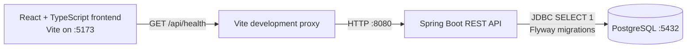

# Week 1 foundation architecture

The Java backend owns application data and database access. The browser calls the API over REST; it does not connect to PostgreSQL. Flyway applies versioned schema changes when the backend starts. In local development, Vite proxies `/api` requests to the backend.
