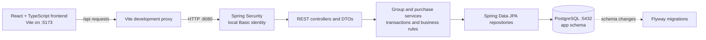
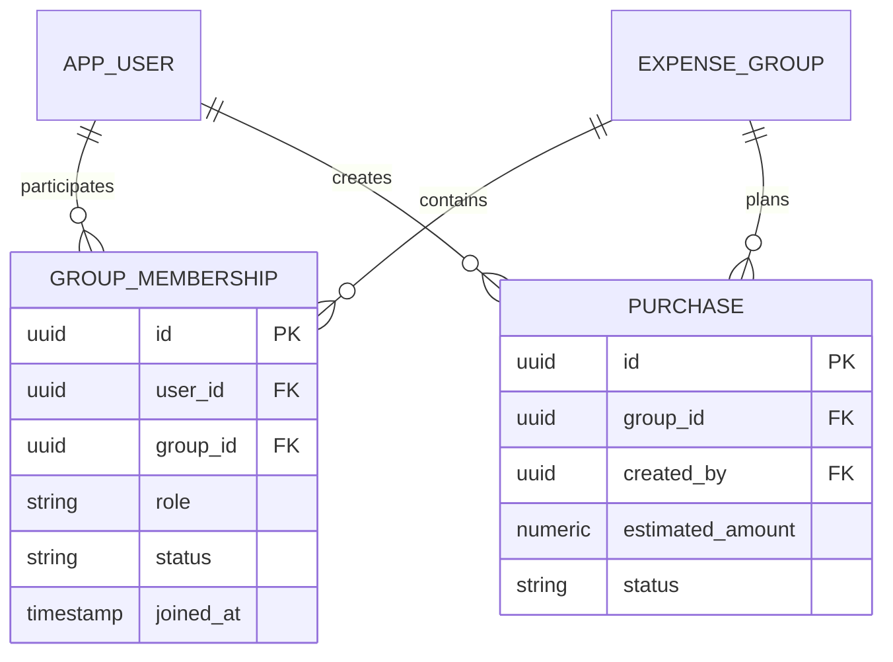

# Week 1 foundation architecture

The Java backend owns application data and database access. The browser calls the API over REST; it does not connect to PostgreSQL. Flyway applies versioned schema changes when the backend starts, and Hibernate validates the mapped schema without changing it.

## Week 2 domain relationships

`GROUP_MEMBERSHIP` is an entity because role and active/left status are domain state. The unique `(group_id, user_id)` constraint prevents duplicate membership records. A purchase separately references its group and creator; active group membership is checked by the application service before purchase creation. The local HTTP Basic principal is mapped by email to an application user and is explicitly not production authentication.
