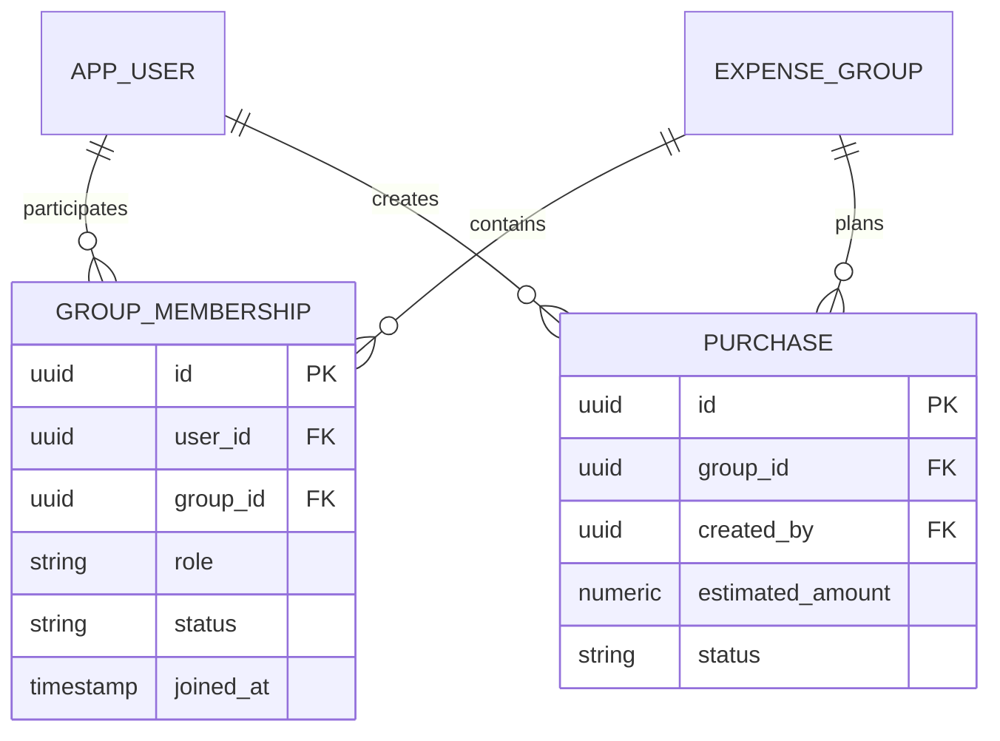
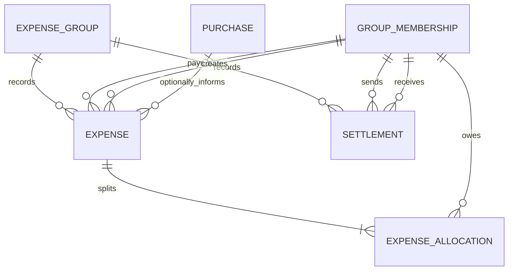
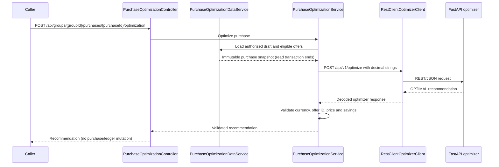

# Paisa Vasool architecture

```mermaid
flowchart LR
    Browser[React + TypeScript frontend\nVite on :5173] -->|/api requests| Proxy[Vite development proxy]
    Proxy -->|HTTP :8080| Security[Spring Security\nlocal Basic identity]
    Security --> API[REST controllers and DTOs]
    API --> Services[Group and purchase services\ntransactions and business rules]
    Services[Group, purchase, expense, balance, and settlement services] --> Repositories[Spring Data JPA repositories]
    Repositories --> DB[(PostgreSQL :5432\napp schema)]
    DB -. schema changes .-> Flyway[Flyway migrations]
```

The Java backend owns application data and database access. The browser calls the API over REST; it does not connect to PostgreSQL or call the Python optimizer. Authenticated `GET /api/groups` lists only the current user's active group memberships so the UI can populate its group selector. Flyway applies versioned schema changes when the backend starts, and Hibernate validates the mapped schema without changing it.

## Group and purchase domain relationships

`GROUP_MEMBERSHIP` is an entity because role and active/left status are domain state. The unique `(group_id, user_id)` constraint prevents duplicate membership records. A purchase separately references its group and creator; active group membership is checked by the application service before purchase creation. The local HTTP Basic principal is mapped by email to an application user and is explicitly not production authentication.

## Week 3 ledger relationships

An `Expense` is an actual incurred ledger event, separate from a `Purchase` planning estimate. A purchase may remain a draft, be cancelled, or be approved without payment; only a separately recorded expense changes member balances. An expense may optionally link to a purchase for traceability.

Allocations reference `GroupMembership` rather than `User`: the share is owed by a participant in a particular group, and membership gives the ledger an unambiguous group-scoped identity. Each expense has explicit positive allocations whose sum must exactly equal its total. The application validates this cross-row invariant before persistence, and the transactional service ensures that an invalid expense never leaves partial allocation rows.

Expense and settlement writes are append-only through the API. There is no update/delete operation that silently rewrites a financial history; a future correction should be represented as a compensating ledger event. Settlements have no pending state in this MVP and represent a simulated, user-reported event only.

### Currency and balance rules

All ledger amounts are INR `NUMERIC(12,2)` / Java `BigDecimal`. Values with more than two fractional digits or outside the supported precision are rejected; the ledger never rounds an explicit amount. No automatic equal-split helper is provided, so each allocation (including any deterministic remainder) is stated explicitly by the caller.

The balance sign convention is consistent throughout the service and API:

- Positive balance: a member should receive money.
- Negative balance: a member owes money.
- Zero: settled.

For each expense, the payer receives a credit of the full total, while each allocated member receives a debit for their share. For a settlement from sender to recipient, the sender's balance increases and the recipient's balance decreases by the settlement amount. Every ledger calculation starts with all group memberships (including members who later left), applies expense totals, allocations, and settlements, then verifies the group sum is exactly zero. Settlement creation requires an active sender who currently owes and an active recipient currently owed; the amount cannot exceed either current net balance.

Expense and settlement creation take a pessimistic lock on the group row. This serializes changes within one group's ledger so settlement validation observes prior committed writes, rather than racing another ledger write. Balance queries use aggregate projections and batched reads rather than loading JPA relationship graphs.

## Week 6 purchase optimization integration

Java owns authentication, group membership, draft-state checks, catalog reads, eligibility, and the final validation of the recommendation. The Python service is stateless and only chooses among the candidates Java supplies. External HTTP work occurs after the short read-only database transaction has ended. The recommendation is not persisted and is not approval or proof of purchase. Connection, HTTP, timeout, and malformed-response failures are surfaced as `503` Problem Details; the backend does not retry the POST or return fallback savings. The backend's optimizer URL and connect/read timeouts are configurable with `OPTIMIZER_BASE_URL`, `OPTIMIZER_CONNECT_TIMEOUT`, and `OPTIMIZER_READ_TIMEOUT`.
