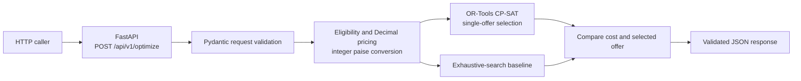

# Week 5 optimizer architecture

## Service boundary

The service receives the complete purchase amount, evaluation time, and candidate offer terms in each request. It has no persistence layer or Java-owned state. Pydantic validates the request; a pure pricing component derives candidate eligibility and exact discount amounts; CP-SAT selects among the no-offer baseline and eligible discounts. The independent exhaustive search must agree with the solver before the response is returned.

## Ownership and integration

- Java remains authoritative for users, group authorization, catalog data, purchase state, and the expense ledger.
- The optimizer does not connect to PostgreSQL, authorize a user, approve or update a purchase, record an expense, or execute a payment.
- The request's `active`, validity, and discount fields are supplied inputs. The service checks that those fields are internally consistent and computes eligibility, but cannot verify who is allowed to use an offer or whether supplied catalog data is current.
- The standalone HTTP service is implemented in Week 5. Java-to-Python REST integration is planned for Week 6 and is not present in the current system.

## Runtime components

`app.main` exposes the versioned optimization endpoint and a health route. `app.models` defines strict Pydantic input/output contracts. `app.pricing` validates the INR/paise rules and implements deterministic eligibility, discount calculation, and the exhaustive baseline. `app.solver` builds the binary CP-SAT choice model, applies deterministic tie-breaking, and checks the result against that baseline.
