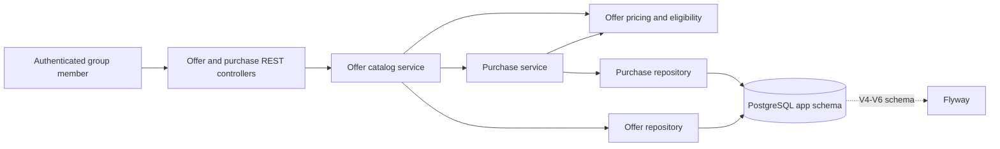
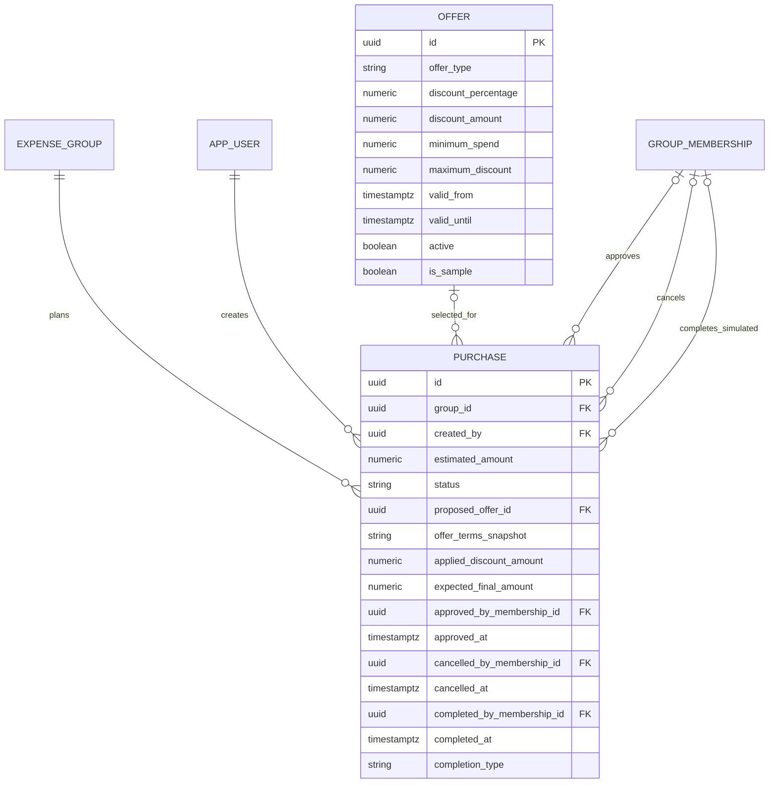

# Week 4 offer and purchase workflow

## Service and persistence flow

The catalog service enforces active group membership for browsing, details, and purchase-specific eligibility. Pricing is a deterministic domain component: it receives an offer, amount, and evaluation instant and returns either a typed rejection reason or the calculated discount and payable. It does not persist data or handle HTTP.

## Domain relationships

`Purchase` holds a nullable reference to the selected catalog offer and a copy of the terms used for its proposal. The snapshot includes merchant and offer wording, discount type/value, minimum spend, cap, validity interval, terms, applied discount, payable, and proposal time. Subsequent catalog changes therefore do not rewrite a proposal's price or explanation. The snapshot is part of the purchase aggregate, not a second entity with a duplicate lifecycle.

## Price and lifecycle rules

- Only percentage and fixed discounts are supported; gift cards are deferred because their face value is stored value, not savings.
- Monetary values use INR `BigDecimal` / `NUMERIC(12,2)`. Percentage discounts use `NUMERIC(5,2)`.
- Offer validity is start-inclusive and end-exclusive. Inactive, not-yet-valid, expired, and below-minimum offers are rejected with typed reasons.
- Percentage discount is rounded to paise using `HALF_UP`; an optional percentage cap is applied, followed by a cap at the purchase amount. Final payable is never negative.
- One eligible offer can be attached to a draft purchase. The service re-evaluates eligibility at proposal submission; client-provided discount and payable values are not accepted.
- The lifecycle is `DRAFT → PENDING_APPROVAL → APPROVED → COMPLETED`, with cancellation permitted from draft, pending, or approved states. Invalid transitions are conflicts.
- Active group members can propose, approve, cancel, and record completion under the existing authorization policy. `OWNER` and `MEMBER` roles do not currently have different action permissions.
- Approval, cancellation, and completion record the authenticated membership and action timestamp. Completion is explicitly `SIMULATED`; it does not execute or verify payment.
- Purchase workflow actions do not create `Expense` rows. The Week 3 expense ledger remains the source for recorded expenses and calculated balances.

Flyway V4 creates the offer catalog and fictional sample entries, V5 adds purchase proposal snapshots, and V6 adds workflow audit fields. Each migration is additive; Hibernate validates the resulting schema.
